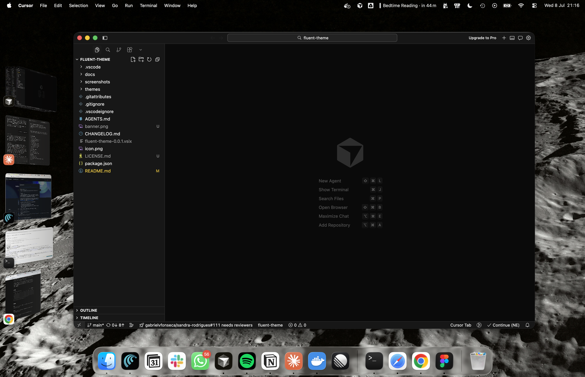
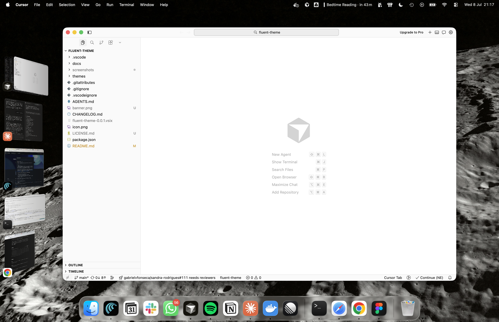

# Fluent Theme

<a href="https://github.com/gabrielvfonseca/fluent-theme/releases">
  
</a>
<a href="https://github.com/gabrielvfonseca/fluent-theme/blob/main/LICENSE.md">
  
</a>
<a href="https://code.visualstudio.com/updates/v1_98">
  
</a>
<a href="https://github.com/gabrielvfonseca/fluent-theme/issues">
  
</a>

A sleek, clean, and distraction-free theme for Visual Studio Code, Cursor, and other VS Code-compatible editors.
<br/>
Available in <b>Dark</b> and <b>Light</b> variants.

## Features

- **Dark** & **Light** themes — two carefully crafted variants
- High contrast for superior readability
- Consistent color hierarchy across both themes
- Semantic token highlighting for modern language server support
- Customized markdown styling with clear heading hierarchy
- Optimized terminal colors for better visibility
- Full UI customization — activity bar, sidebar, tabs, status bar, and more
- Support for multiple languages and file types

## Preview

<table>
  <tr>
    <th>Dark Theme</th>
    <th>Light Theme</th>
  </tr>
  <tr>
    <td></td>
    <td></td>
  </tr>
</table>

## Install

### From VS Code Marketplace
Search for **Fluent Theme** in the Extensions view (`Cmd+Shift+X` or `Ctrl+Shift+X`).

### From VSIX
1. Download the `.vsix` file from the [releases page](https://github.com/gabrielvfonseca/fluent-theme/releases)
2. In VS Code, go to Extensions → `...` → Install from VSIX...
3. Select the downloaded file

### Manual Install
1. Clone the repository:
   ```
   git clone https://github.com/gabrielvfonseca/fluent-theme.git
   ```
2. Copy the `fluent-theme` folder to your VS Code extensions directory:
   - **Windows**: `%USERPROFILE%\.vscode\extensions`
   - **macOS / Linux**: `~/.vscode/extensions`
3. Reload your editor
4. Open the Command Palette (`Cmd+Shift+P` or `Ctrl+Shift+P`) → **Color Theme** → Select **Dark** or **Light**

## Contributing

Contributions are welcome! Feel free to [open an issue](https://github.com/gabrielvfonseca/fluent-theme/issues) or submit a pull request.

## License

MIT — see the [LICENSE.md](./LICENSE.md) file for details.